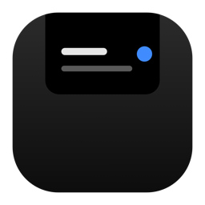
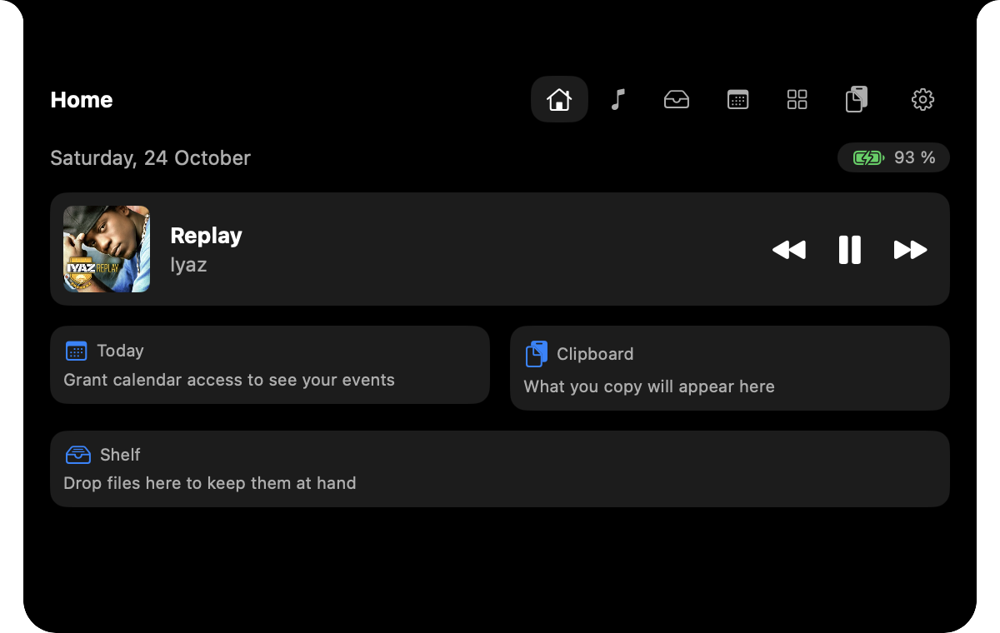
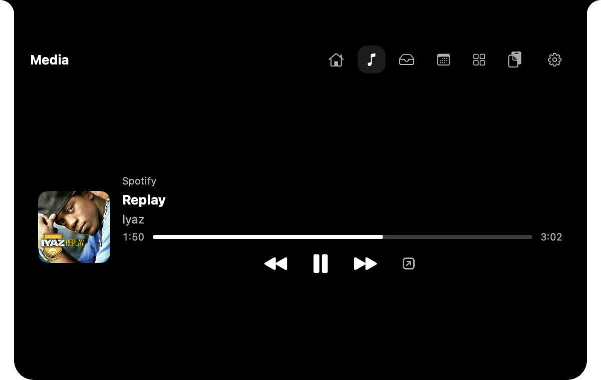
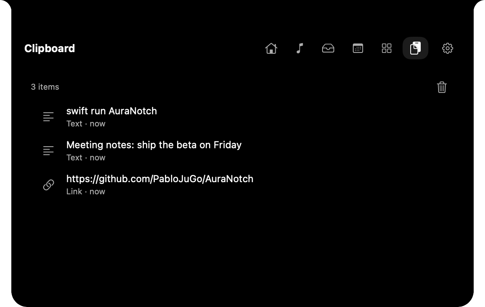

<div align="center">



# Aura Notch

**Convierte el notch del MacBook en un panel útil y discreto.**
Controles de reproducción, una estantería temporal de archivos, tus próximos eventos, un temporizador, volumen, batería e historial del portapapeles, a un gesto de distancia.

[English](README.md) · [Español](README.es.md) · [Français](README.fr.md) · [Deutsch](README.de.md) · [Português (Brasil)](README.pt-BR.md) · [简体中文](README.zh-CN.md)


</div>

Aura Notch es una app nativa de macOS escrita en Swift (SwiftUI + AppKit) y sin dependencias de terceros. Vive en el notch, no estorba y se abre como un panel cuando acercas el puntero. Todo se ejecuta en local: sin cuenta, sin analítica, sin telemetría.

<div align="center">

</div>

## Características

- **Notch cerrado con actividad en vivo.** Un ecualizador animado y el título de la canción aparecen junto al notch mientras suena algo, un temporizador muestra su cuenta atrás y los avisos breves (reunión próxima, cargador conectado, temporizador terminado) se deslizan al aparecer. La forma cerrada tiene un ancho fijo y simétrico, así que nunca crece con el título de la canción y tapa lo mínimo de tu barra de menús.
- **Inicio.** La fecha y la batería de hoy, lo que suena con portada y controles, los eventos de hoy, los elementos recientes del portapapeles y tu estantería, de un vistazo.
- **Multimedia.** Música y Spotify: título, artista, progreso y búsqueda, reproducir/pausar/siguiente/anterior al estilo de macOS. Desliza dos dedos sobre el notch cerrado para cambiar de canción. La portada de Spotify es opcional y es lo único que la app descarga.
- **Estantería.** Arrastra archivos o enlaces hacia el notch y se abre para recibirlos. La estantería guarda referencias y nunca mueve ni borra tus originales. Abrir, mostrar en Finder, copiar la ruta, compartir o enviar por AirDrop, y volver a arrastrar los elementos hacia fuera. Conservarla entre sesiones es opcional.
- **Calendario.** Tus próximos eventos, en solo lectura, mediante EventKit y con permiso explícito.
- **Widgets.** Temporizador, volumen, batería, fecha y acciones rápidas, dispuestos en una rejilla ordenada de dos columnas.
- **Historial del portapapeles (opcional).** Texto, enlaces e imágenes, guardados solo en memoria. Ignora los elementos marcados como ocultos o transitorios (como los de los gestores de contraseñas) y está desactivado hasta que lo actives.
- **Temas e idiomas.** Elige un color de acento y el tamaño del notch cerrado. La interfaz está disponible en inglés, español, francés, alemán, portugués de Brasil y chino simplificado.
- **Buen ciudadano.** Panel que no se activa y nunca roba el foco, atajo global (`⌃⌥N`), icono en la barra de menús, apertura al iniciar sesión, respeta *Reducir movimiento*, se oculta sobre apps a pantalla completa (configurable) y en reposo consume cerca de un 0 % de CPU.
- **Funciona sin notch.** En Macs y pantallas sin notch se convierte en una pequeña píldora flotante en la parte superior central de la pantalla.

<div align="center">
 
</div>

## Instalación

1. Descarga `AuraNotch.zip` desde la [última versión](https://github.com/PabloJuGo/AuraNotch/releases/latest) y descomprímelo.
2. Arrastra **AuraNotch.app** a tu carpeta Aplicaciones.
3. La primera vez, haz **clic derecho > Abrir** sobre la app y confirma. La app está firmada ad hoc pero no notarizada (la notarización requiere una cuenta de desarrollador de Apple de pago), así que macOS te pide aprobarla una vez. Si macOS aún la rechaza, ejecuta:
   ```sh
   xattr -dr com.apple.quarantine /Applications/AuraNotch.app
   ```
4. Busca la franja del notch en la parte superior de la pantalla (y el icono en la barra de menús). Pasa el puntero o haz clic, o pulsa `⌃⌥N`.

**Requisitos:** macOS 14 o posterior. Se desarrolló y probó en un MacBook con notch con macOS 27; otras configuraciones deberían funcionar, pero se han probado menos.

## Ajustes

Abre **Ajustes** desde el engranaje de la cabecera del panel o desde el icono de la barra de menús.

| Sección | Qué puedes cambiar |
|---|---|
| General | Abrir al iniciar sesión, modo de pantalla, **idioma de la interfaz**, color de acento, tamaño del notch cerrado |
| Interacción | Abrir al pasar el puntero, al hacer clic o con el atajo global; retraso al pasar el puntero; comportamiento en pantalla completa; título en el notch cerrado; deslizar para cambiar de canción; avisos |
| Animaciones | Movimiento (seguir al sistema, reducido o sin animaciones) |
| Módulos | Activar, desactivar y reordenar Inicio, Multimedia, Estantería, Calendario, Widgets y Portapapeles |
| Privacidad | Conservar la estantería entre sesiones, límite del historial, portada de Spotify, borrar todos los datos |

El cambio de idioma se aplica tras reiniciar; la app ofrece un botón **Reiniciar ahora**.

## Privacidad y permisos

- Sin cuenta, sin analítica, sin telemetría, sin comprobación de actualizaciones.
- **Red:** la única petición es la imagen de portada de Spotify, desde la dirección que expone el propio Spotify. Puedes desactivarla en Ajustes → Privacidad.
- **Los permisos se piden solo cuando usas la función que los necesita:** *Automatización* para controlar Música y Spotify (ver qué suena no requiere permiso) y *Calendarios* para listar tus eventos (solo lectura).
- La estantería guarda referencias a tus archivos, el historial del portapapeles vive solo en memoria y **Ajustes → Privacidad → Borrar todos los datos** lo elimina todo.

Más detalles en [PRIVACY.md](PRIVACY.md) y [SECURITY.md](SECURITY.md) (por ahora, ambos en español).

## Compilar desde el código fuente

Solo necesitas la toolchain de Swift 6 (las Xcode Command Line Tools bastan).

```sh
git clone https://github.com/PabloJuGo/AuraNotch.git
cd AuraNotch
swift build
swift run AuraSelfTests            # test suite with detailed failures
swift run AuraNotch                # run without packaging (no Calendar/Automation prompts)
Scripts/package-app.sh             # builds dist/AuraNotch.app (release, ad-hoc signed)
```

Opciones útiles: `--skip-onboarding`, `--start-module=<home|media|shelf|calendar|widgets|clipboard>`.

Las notas de arquitectura están en [ARCHITECTURE.md](ARCHITECTURE.md) y las decisiones de diseño en [Docs/decisions](Docs/decisions) (en español).

## Estado y limitaciones conocidas

Aura Notch está en **beta**. Conviene saber que:

- No está notarizada (ver Instalación). No hay actualización automática.
- Los flujos de Calendario y AirDrop dependen de permisos y diálogos del sistema y se han probado poco en hardware real.
- Las pantallas externas, el uso de varias pantallas y VoiceOver se han probado poco en la práctica.
- El aviso del permiso de Automatización de Spotify puede tardar en aparecer en las versiones recientes de macOS; entonces macOS lo pregunta la primera vez que pulsas un control.
- Las traducciones distintas del inglés y el español se hicieron con ayuda automática y no las han revisado hablantes nativos. Las correcciones son muy bienvenidas.
- Algunos documentos del proyecto (notas de arquitectura, decisiones, privacidad) siguen en español.

## Contribuir

Las incidencias y los pull requests son bienvenidos; consulta [CONTRIBUTING.md](CONTRIBUTING.md). Para corregir o añadir una traducción, edita `Resources/<language>.lproj/Localizable.strings` y ejecuta `Scripts/check-localizations.py`.

## Licencia

[MIT](LICENSE). Aura Notch es un proyecto independiente y no está afiliado a Apple, Spotify ni a ninguna otra app mencionada aquí.
